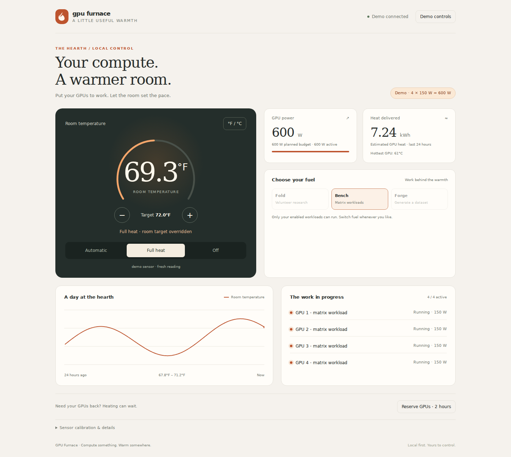

<div align="center">

# GPU Furnace

### Compute something. Warm somewhere.


A local thermostat for the useful heat your GPUs already make.<br>
**AMD + NVIDIA · Python standard library · Phone + desktop · Self-hosted**

[Try the demo](#try-it-without-a-gpu) · [Set up your rig](#run-it-for-real) · [Workloads](docs/workloads.md) · [Deployment](docs/deployment.md)



</div>

GPU Furnace starts and stops workloads as the room needs warmth. A browser dashboard gives you a thermostat, fuel selection, live power readings, temperature history, and a quick way to reserve your GPUs for something else.

It works with your commands, systemd services, and local inference server. No cloud account, bundled model, custom container image, or particular GPU rig required.

| A thermostat for compute | Your GPUs come first | Start without hardware |
| --- | --- | --- |
| Room sensor → demand → useful work | Reserve the cards instantly for your own jobs | Interactive demo with a simulated 600 W rig |

## Try it without a GPU

Requires Linux and Python 3.10+ for the controller. The simulated preview can also run on macOS.

```bash
git clone https://github.com/PraxisOG/gpu-furnace-v2.git gpu-furnace
cd gpu-furnace
python3 heatd/heatd.py --demo
```

Open **http://127.0.0.1:8787**. The preview simulates four 150 W GPUs, includes a day of sample history, and lets you try the controls. It launches no GPU work and keeps its state in a temporary directory. Demo mode only listens on loopback.

## The 600 W example

The example rig uses **4 GPUs × 150 W per GPU = 600 W total GPU power**.

| Active GPUs at 150 W each | GPU power | Approximate GPU heat per hour |
| --- | ---: | ---: |
| 1 | 150 W | 0.15 kWh |
| 2 | 300 W | 0.30 kWh |
| 3 | 450 W | 0.45 kWh |
| 4 | **600 W** | **0.60 kWh** |

At a steady 600 W, the GPUs produce about **2,047 BTU/h** of heat. CPU, fans, memory, and PSU losses add to the whole system’s draw and heat. Use a wall meter to measure that total.

**`max_watts` is a planning budget, not a hardware power limit.** Set each GPU’s actual power limit with the tools supported by your card and driver. A workload’s `watts` is its estimated total draw; one command using all four cards should be budgeted at 600 W, not 150 W. The controller cannot cap unrelated inference or other processes.

## Run it for real

```bash
# Create private local config and a random control token. Starts no jobs.
bash scripts/setup.sh

# Check your configuration before starting the controller.
python3 heatd/heatd.py --config ~/.config/gpu-furnace/workloads.json --check

# Start the controller. By default it only listens on this machine.
python3 heatd/heatd.py --config ~/.config/gpu-furnace/workloads.json
```

Then:

1. Open **http://127.0.0.1:8787**. Click **Connect controls** and paste the contents of `~/.config/gpu-furnace/control.token`. The token is generated locally and is never printed by the daemon or included in this repository.
2. Edit `~/.config/gpu-furnace/workloads.json`. The four 150 W examples are **disabled initially**. Install a compatible CUDA/ROCm PyTorch build if using `heater.py`, or replace the example commands with your own killable workloads. In a virtual environment, use the absolute Python path in each command. Enable only the GPUs and commands you intend to use, then restart heatd.
3. Supply a **fresh room temperature** to `/temperature` every 30–60 seconds. Use the [ESP32 example](esp32/README.md), Home Assistant, or another HTTP-capable sensor. Automatic heating stops after 120 seconds without a fresh reading. There is no built-in MQTT client.

For phone access, configure a specific LAN address with `FURNACE_HOST` or `--host`. Use a trusted private network or an HTTPS reverse proxy; plain HTTP does not encrypt tokens. See [deployment and upgrading](docs/deployment.md) before replacing an existing installation.

## What keeps the heat in check

- **Automatic:** starts jobs as the room drops below the target/deadband; holds within the band; stops above it. Missing or stale room data stops automatic heating.
- **Full heat:** explicitly bypasses the room target. GPU telemetry, thermal guard, workload budget, and reservations still apply. Full heat is not restored after a restart.
- **Off:** stops managed workloads immediately and persists across restarts.
- **Reserve:** stops managed jobs and prevents heating until released or the reservation expires. This does not unload a separately running inference server.
- **Thermal guard:** stops workloads at the configured hottest GPU temperature; restarts only below the reheat threshold. Missing GPU power or temperature telemetry pauses heating.
- **Shutdown:** SIGINT/SIGTERM stops managed workloads. A crash, power failure, or uncooperative externally managed job can still bypass software cleanup; see [safety](docs/safety.md).

A motherboard SYSTIN estimate is optional. Calibrate it against an actual room thermometer before enabling it. Automatic calibration is off by default because an assumed overnight room temperature is not a measurement.

## API

Read endpoints are unauthenticated so a local display can show the hearth. Every mutating endpoint requires `Authorization: Bearer <your-token>` on real controllers. Tokens in URLs are rejected.

| Endpoint | Method | Body / purpose |
| --- | --- | --- |
| `/` | GET | Responsive dashboard |
| `/status` | GET | Mode, room sensor, GPU power/temperature, configured workloads |
| `/history?hours=24` | GET | Downsampled readings; 0.01–168 hours |
| `/demand` | GET | Active fraction of the selected fuel’s workload ladder |
| `/temperature` | POST | `{"temp_f": 68.5, "src": "room-sensor"}` |
| `/setpoint` | POST | `{"setpoint_f": 70}` or `{"delta_f": 1}` |
| `/mode` | POST | `{"mode": "auto"}`, `"full"`, or `"off"` |
| `/heatmode` | POST | `{"mode": "fold"}`, `"bench"`, or `"forge"`; must have enabled fuel |
| `/reserve` | POST | `{"seconds": 7200, "reason": "inference"}`; maximum 24 hours |
| `/release` | POST | Release the reservation |
| `/offset` | POST | `{"offset_f": 12.5}`; calibrate SYSTIN manually |
| `/calibrate` | POST | Estimate offset from idle GPU edge sensors; approximate |

For an API example without placing the token in a process argument:

```bash
python3 - <<'PY'
import json
from pathlib import Path
from urllib.request import Request, urlopen

token = (Path.home() / '.config/gpu-furnace/control.token').read_text().strip()
request = Request('http://127.0.0.1:8787/reserve',
    data=json.dumps({'seconds': 7200, 'reason': 'inference'}).encode(),
    headers={'Content-Type': 'application/json', 'Authorization': 'Bearer ' + token})
with urlopen(request) as response:
    print(response.read().decode())
PY
```

## Configuration & files

| Location | Purpose |
| --- | --- |
| `heatd/workloads.example.json` | Portable, disabled-by-default 4 × 150 W example |
| `~/.config/gpu-furnace/workloads.json` | Your actual workload configuration |
| `~/.config/gpu-furnace/control.token` | Private control token; owner-only permissions |
| `~/.config/gpu-furnace/furnace.env` | Optional environment file for systemd |
| `~/.local/state/gpu-furnace/` | Saved settings and `readings.jsonl` history |
| `systemd/heatd.service` | Recommended user service |
| `scripts/` | Setup, workloads, and secret checker |

XDG configuration/state directories are respected. `FURNACE_CONFIG`, `FURNACE_STATE`, and `FURNACE_TOKEN_FILE` override paths. JSON needs no extra packages. Existing YAML configurations require PyYAML; parsing errors stop startup instead of silently guessing.

## Development

```bash
python3 -m unittest discover -s tests -v
python3 heatd/heatd.py --check
python3 scripts/check-secrets.py
python3 scripts/check-secrets.py --history
```

CI runs the controller/API tests, configuration validation, shell syntax checks, and credential scans. The secret checker reports locations without printing credential values. It is a heuristic, not a guarantee; revoke any credential that was ever exposed, even after deleting it from Git.

